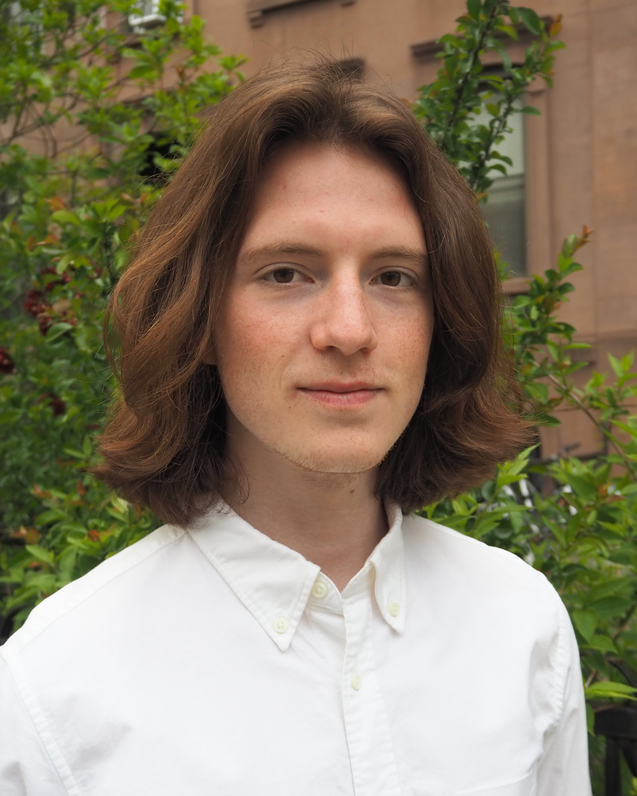
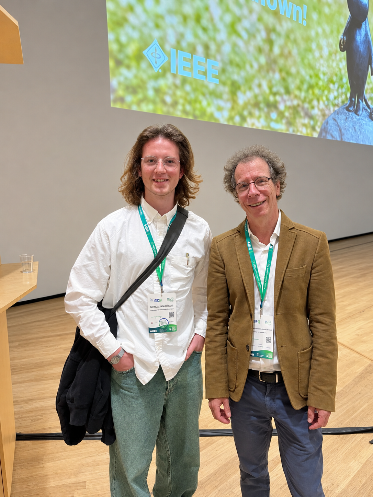

@def title = "Nikola"
@def date = Date(2023, 06, 07)

## About me
@@row
@@container
~~~

~~~

Hello. My name is Nikola Janjušević. I am a Post Doctoral Researcher at the NYU
Langone Health Department of Radiology. I earned my Ph.D. in Electrical
Engineering from *New York University* under the advisory of Professor Yao Wang,
[NYU VideoLab](https://wp.nyu.edu/videolab/), in 2024. I received my Bachelors in
Electrical Engineering from *The Cooper Union for Advancement of Science and
Art* in 2019. 

My current interests are in *interpretable deep-learning* models for solving
noisy imaging inverse problems without ground-truth data. My
background is in *signal-processing*, *non-smooth convex optimization*, and deep-learning.
Outside of academia, I go climbing, biking, and skateboarding with my friends.

Email me at **nikola at nyu dot edu**.
@@
@@

## Updates
* [October 2026] The preprint version of our [Longitudinal MRI Reconstruciton paper](https://arxiv.org/abs/2610.22643) is online.
* [May 2026] Our [ImMAP Paper](https://arxiv.org/abs/2511.11963) was accpted to IEEE ICIP 2026! (Did I) see you in Tampere?
@@container
~~~

~~~
@@

## Recent blog posts
{{recentposts blog}}
